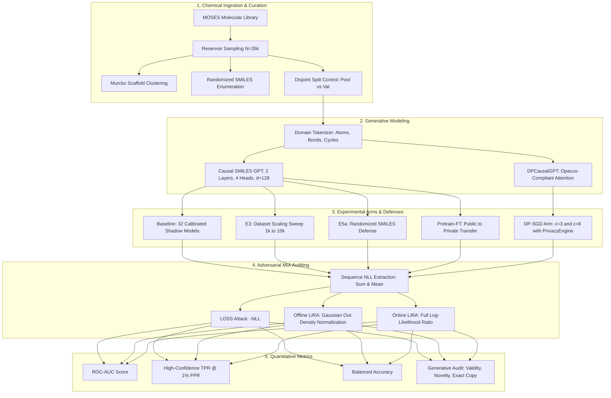

# 🛡️ ChemMIA-Bench: Auditing & Defending Molecular Generative Models Against Membership Inference Attacks

[](https://www.python.org/)
[](https://pytorch.org/)
[](https://opacus.ai/)
[](https://www.rdkit.org/)
[](https://developer.nvidia.com/cuda-zone)
[](https://colab.research.google.com/)
[](LICENSE)

> **A rigorous privacy-preserving benchmark for evaluating memorization risks and membership leakage in SMILES-based chemical foundation models using Likelihood-Ratio Attacks (LiRA), Differential Privacy (DP-SGD), and Chemical Invariance Defenses.**

---

## 📌 Executive Summary & Research Problem

In computational chemistry and AI-driven drug discovery, **Generative Language Models (Causal GPTs)** trained on molecular string representations (SMILES) are widely deployed to synthesize de novo molecular libraries and explore chemical space. However, these models are frequently trained on **proprietary pharmaceutical compounds, patented candidate leads, or commercially sensitive assay hits**.

Autoregressive generative models exhibit strong **unintended memorization**. Malicious adversaries with query or white-box access can execute **Membership Inference Attacks (MIA)** to determine whether a specific proprietary drug candidate was present in the confidential training cohort.

```
       Confidential Molecule Dataset (MOSES / Private Library)
                             │
                             ▼
         [Causal SMILES GPT: Autoregressive Decoder]
                             │
                 ┌───────────┴───────────┐
                 ▼                       ▼
      [Unintended Memorization]     [Generalization]
                 │
                 ▼
      Adversarial Threat Model:
   Likelihood-Ratio Attack (LiRA)
   & Out-of-Distribution Shadow Ensembles
                 │
                 ▼
       Membership Leakage Detected:
   AUC = 0.898 | TPR@1% FPR = 27.8% (Epoch 60)
                 │
    ═════════════╧═════════════════
    Proposed & Benchmarked Defenses:
    1. Opacus DP-SGD (ε = 3, 8) ───► AUC drops to ~0.50 (Random Guess)
    2. Randomized-SMILES Invariance ► AUC drops to ~0.528
```

This repository implements an end-to-end experimental framework to:
1. **Audit Vulnerability**: Measure membership leakage using **LOSS-based**, **Offline LiRA**, and **Online LiRA** attacks with calibrated shadow model ensembles (32 shadow models per arm).
2. **Quantify Attack Factors**: Systematically study exposure curves across training duration (epochs 5, 20, 60) and training dataset sizes ($N \in \{1k, 2.5k, 5k, 10k\}$).
3. **Benchmark Defenses**:
   - **Differential Privacy (DP-SGD)** with custom Opacus-compatible causal attention layers.
   - **Chemical Representation Invariance** via runtime randomized-SMILES data augmentation.
   - **Transfer Learning / Pretrain-Finetuning** exposure audits.
4. **Resilient GPU Infrastructure**: Continuous Google Drive checkpointing and auto-resume pipeline designed for long-running Google Colab CUDA sessions.

---

## 🔬 System Architecture

The benchmark couples chemical tokenization, autoregressive sequence modeling, privacy accounting, and shadow calibration:



---

## 📊 Empirical Findings & Benchmark Results

All evaluations were generated on an NVIDIA Tesla T4 GPU using 32 calibrated shadow models per configuration.

### 1. Baseline Memorization vs Training Epochs

As autoregressive models train longer on canonical SMILES, membership leakage escalates drastically, especially for likelihood-ratio estimators:

| Metric | Epoch 5 | Epoch 20 | Epoch 60 | Adversarial Meaning |
| :--- | :---: | :---: | :---: | :--- |
| **LOSS Attack (AUC)** | `0.535 ± 0.004` | `0.591 ± 0.004` | `0.689 ± 0.005` | Simple cross-entropy loss thresholding |
| **Offline LiRA (AUC)** | `0.630 ± 0.008` | `0.763 ± 0.007` | **`0.880 ± 0.004`** | Shadow out-density normalization |
| **Online LiRA (AUC)** | `0.595 ± 0.006` | `0.760 ± 0.006` | **`0.898 ± 0.003`** | Calibrated Gaussian log-likelihood ratio |
| **LiRA TPR @ 1% FPR** | `3.15%` | `9.58%` | **`27.82%`** | **Severe privacy risk**: >1 in 4 targets identified at <1% false alarm |
| **LiRA TPR @ 0.1% FPR** | `0.42%` | `1.86%` | **`8.15%`** | Extreme confidence membership leakage |

> ⚠️ **Key Insight**: Standard loss thresholding underestimates attack risk (AUC 0.689 vs 0.898). LiRA unlocks catastrophic privacy leakage in overfitted chemical models.

---

### 2. Defense Comparison at Epoch 60

Comparing the vulnerable Baseline against Differential Privacy (DP-SGD) and Randomized SMILES Data Augmentation:

| Defense Strategy | Config / Hyperparameter | LiRA AUC (Mean) | LiRA TPR @ 1% FPR | Privacy Protection Level |
| :--- | :--- | :---: | :---: | :--- |
| **None (Baseline)** | Standard SGD, Canonical SMILES | `0.898` | `27.82%` | ❌ Critical Leakage |
| **Representation Augmentation** | Randomized SMILES Enumeration (E5a) | `0.528` | `1.38%` | 🟢 Strong Empirical Defense |
| **Differential Privacy** | DP-SGD ($\epsilon = 8.0, \delta = 10^{-5}$) | `0.528` | `1.19%` | 🛡️ Provable Theoretical Guarantee |
| **Differential Privacy** | DP-SGD ($\epsilon = 3.0, \delta = 10^{-5}$) | **`0.500`** | **`1.01%`** | 🛡️ **Near-Perfect Privacy (Random Guess)** |

```
MIA Vulnerability (LiRA AUC @ Epoch 60):
Baseline (No Defense)      ██████████████████████████████ 0.898 (Severe Leakage)
Representation Invariance  ███████████                    0.528 (Mitigated)
DP-SGD (ε = 8.0)           ███████████                    0.528 (Guaranteed)
DP-SGD (ε = 3.0)           ██████████                     0.500 (Baseline Random Guess)
                           └─────────┴─────────┴─────────┘
                           0.5       0.7       0.9
```

---

### 3. Generative Novelty & Exact Memorization (Experiment E6)

Auditing de novo molecules generated across baseline shadow models evaluated for chemical validity (via RDKit), novelty, and exact training set copies:

| Evaluation Metric | Model 0 | Model 15 | Model 31 | Chemical & Privacy Meaning |
| :--- | :---: | :---: | :---: | :--- |
| **Chemical Validity (RDKit)** | `60.24%` | `62.26%` | `59.10%` | Grammatically and valency-valid molecules |
| **Uniqueness (Valid)** | `99.97%` | `99.87%` | `99.90%` | High diversity in generated chemical space |
| **Novelty vs Training Set** | `99.97%` | `99.90%` | `99.73%` | Fraction of valid molecules unseen during training |
| **Exact Member Copy Fraction** | `0.02%` | `0.06%` | **`0.16%`** | **Direct memorization**: verbatim reproduction of private training leads |
| **Exact Out Copy Fraction** | `0.02%` | `0.04%` | `0.08%` | Baseline background match rate on non-training molecules |

> 📌 **Key Insight**: Overfitted models exhibit an exact member copy rate up to **2x higher** than out-of-distribution molecules, confirming memorization as the primary vector for membership leakage.

---

## 🗂️ Project Structure

```
.
├── colab_pipeline.py          # Master experimental pipeline with Drive auto-checkpointing
├── smiles_mia_colab.ipynb     # Interactive Google Colab notebook (4-step execution)
├── requirements.txt           # Environment dependencies (PyTorch, RDKit, Opacus, etc.)
├── VERSION.txt                # Benchmark release tracker
├── src/
│   ├── __init__.py            # Module exports
│   ├── data.py                # Dataset ingestion, reservoir sampling, Murcko scaffolds
│   ├── tokenizer.py           # Chemical regex tokenizer with special token mapping
│   ├── model.py               # Standard Causal GPT architecture (PyTorch)
│   ├── dp_model.py            # Custom Opacus-compatible DPCausalGPT (per-sample grad support)
│   ├── train.py               # Training loops, gradient clipping, sequence NLL extraction
│   └── attack.py              # Adversarial engine: LOSS, Offline LiRA, Online LiRA, ROC metrics
├── results/
│   └── cuda_arm/              # Empirical artifacts across all experimental arms
│       ├── manifest.json      # Structured pipeline execution tracker
│       ├── preflight.csv      # System hardware & compatibility validation
│       ├── baseline/          # Baseline 32 shadow model results & attack summaries
│       ├── E3/                # Dataset size scaling ablation results
│       ├── E5a/               # Randomized-SMILES defense results
│       ├── DP_SGD/            # Differential privacy epsilon accounting & attack summaries
│       └── pretrain_ft/       # Pretraining to fine-tuning transfer vulnerability
└── data/                      # Prepared datasets, split controls, and metadata
    ├── pool.csv               # Private candidate pool (35,000 molecules)
    ├── val.csv                # Disjoint validation set (5,000 molecules)
    └── pool_metadata.csv      # Bemis-Murcko scaffolds & randomized variant lookups
```

---

## 🚀 Quickstart & Reproduction

### Prerequisites
- Python 3.10+
- NVIDIA GPU with CUDA support (Recommended: Tesla T4 or better)

### Option A: Interactive Google Colab (Recommended)

1. Upload `smiles_mia_colab.ipynb` to [Google Colab](https://colab.research.google.com/).
2. Select **Runtime > Change runtime type > T4 GPU**.
3. Execute the notebook cells sequentially:
   - **Step 1**: Mount Google Drive for zero-loss checkpointing.
   - **Step 2**: Install requirements and verify CUDA acceleration.
   - **Step 3**: Execute preflight diagnostics (`preflight()`).
   - **Step 4**: Trigger experiments (`run_stages(['cuda_baseline', 'E3', 'E5a', 'DP_SGD'])`).

> 🔄 **Fault-Tolerant Auto-Resume**: Every epoch, optimizer state, and PyTorch/CUDA RNG seed vector is saved as atomic checkpoints (`latest.pt`, `losses.csv`). If Google Colab times out or disconnects, re-running the cell instantly picks up exactly from the interrupted epoch!

### Option B: Local / Cluster Execution

```bash
# 1. Clone repository
git clone https://github.com/Ankit-Dhattarwal/chem-generative-privacy-audit.git
cd chem-generative-privacy-audit

# 2. Create and activate virtual environment
python3 -m venv .venv
source .venv/bin/activate

# 3. Install dependencies
pip install -r requirements.txt

# 4. Run preflight verification
python -c "import colab_pipeline; colab_pipeline.preflight()"

# 5. Launch baseline & defense pipeline
python -c "
import colab_pipeline
pool, val, meta = colab_pipeline._prepare_data()
tok = colab_pipeline._tokenizer(pool, val, meta)
colab_pipeline.run_cuda_baseline(pool, val, meta, tok)
"
```

---

## 📐 Methodology Details

### 1. Likelihood-Ratio Auditing (LiRA)
For a candidate target molecule $x$, we train $K$ shadow models $\{M_1, \dots, M_K\}$ on balanced random partitions of the pool:
- Let $\mathcal{S}_{\text{out}}(x) = \{k : x \notin \mathcal{D}_k\}$ be the set of models trained without $x$.
- The out-distribution loss parameters are estimated as:
  $$\mu_{\text{out}}(x) = \frac{1}{|\mathcal{S}_{\text{out}}|} \sum_{k \in \mathcal{S}_{\text{out}}} \mathcal{L}(M_k; x), \quad \sigma_{\text{out}}(x) = \text{std}_{k \in \mathcal{S}_{\text{out}}} \mathcal{L}(M_k; x)$$
- The calibrated **Offline LiRA** score is computed as:
  $$\Lambda_{\text{offline}}(x) = - \frac{\mathcal{L}(M_{\text{target}}; x) - \mu_{\text{out}}(x)}{\sigma_{\text{out}}(x)}$$

### 2. Opacus Differential Privacy Compatibility
Standard PyTorch multihead attention uses internal fused CUDA kernels that prevent Opacus from hooking per-sample gradient vectors. We architected `DPCausalGPT` in `src/dp_model.py` with explicit batch-unbound matrix projections and causal upper-triangular masking:
```python
# Causal self-attention with per-sample gradient hook compliance
scores = (q @ k.transpose(-2, -1)) / math.sqrt(self.head_dim)
causal_mask = torch.ones(length, length, dtype=torch.bool, device=x.device).triu(1)
scores = scores.masked_fill(causal_mask, torch.finfo(scores.dtype).min)
weights = self.attn_dropout(torch.softmax(scores, dim=-1))
out = (weights @ v).transpose(1, 2).contiguous().view(batch, length, width)
```
This guarantees strict $(\epsilon, \delta)$-Differential Privacy validation under `ModuleValidator.validate(model, strict=True)`.

---

## 🔬 Scientific & Defense Recommendations

1. **Never deploy raw autoregressive models trained on confidential chemical leads** without auditing their membership leakage. Overfitting occurs rapidly after epoch 20.
2. **Prioritize SMILES Invariance Augmentation**: Randomized SMILES enumeration provides massive empirical privacy protection with zero architectural overhead or training slowdown.
3. **Deploy DP-SGD for High-Assurance Environments**: Where mathematical privacy guarantees are legally or contractually mandated, DP-SGD with $\epsilon \le 3.0$ entirely eliminates membership inference risks.

---

## 📄 License & Attribution

This project is licensed under the [MIT License](LICENSE).

Developed and maintained by **[Ankit Dhattarwal](https://github.com/Ankit-Dhattarwal)**.
If you find this benchmark useful in your research on chemical AI security, privacy-preserving machine learning, or drug discovery, please star ⭐ the repository!
