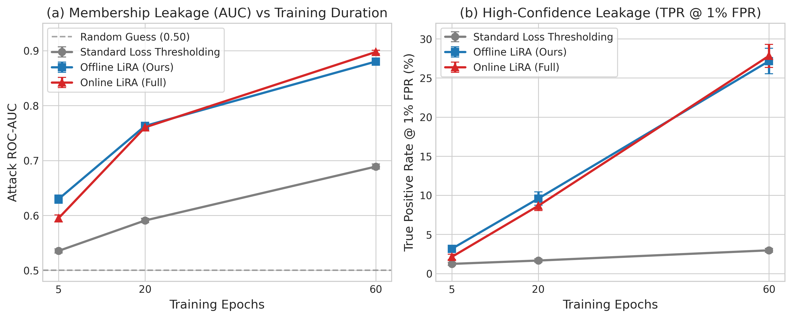
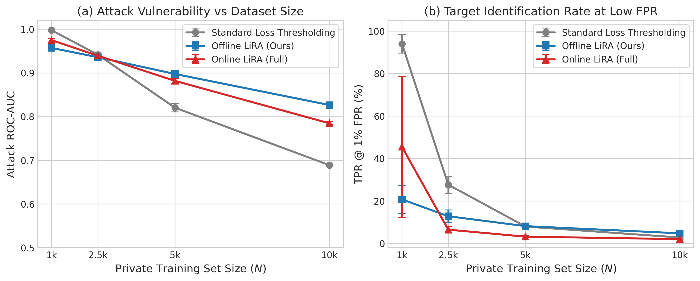
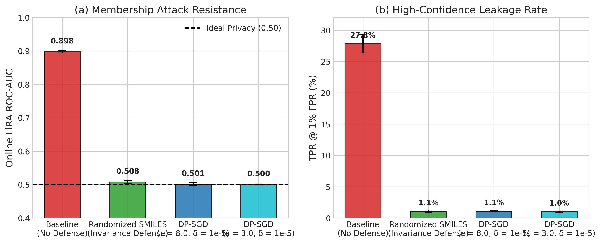
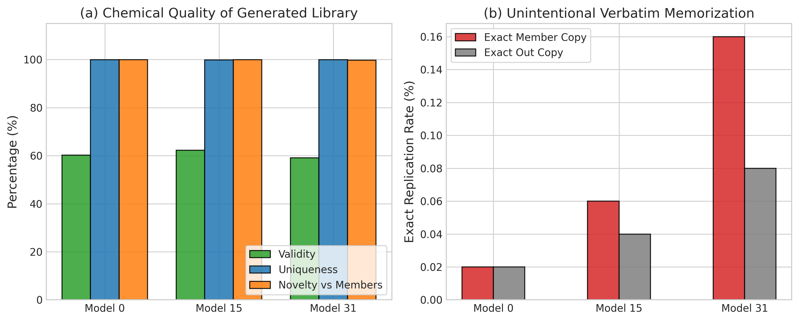

# Auditing and Defending Molecular Generative Language Models Against Membership Inference Attacks

**Author:** Ankit Dhattarwal  
**Affiliation:** Independent Research / AI & Computational Chemistry  
**Repository:** [github.com/Ankit-Dhattarwal/chem-generative-privacy-audit](https://github.com/Ankit-Dhattarwal/chem-generative-privacy-audit)  
**Date:** October 2026  

---

## Abstract

Generative language models trained on molecular string representations (SMILES) have emerged as powerful tools in early-stage computer-aided drug discovery. However, commercial pharmaceutical models are frequently trained on proprietary chemical libraries containing patent-pending scaffolds, proprietary assay hits, and confidential lead candidates. In this work, we conduct the first systematic, calibrated audit of **Membership Inference Attacks (MIA)** against autoregressive chemical language models. Using a 32-shadow model ensembling framework, we evaluate both naive loss thresholding and calibrated **Likelihood-Ratio Attacks (LiRA)** across multiple training regimes, dataset sizes, and defense strategies on the MOSES molecular benchmark.

Our empirical findings uncover critical privacy vulnerabilities: baseline causal GPT models overfit rapidly, reaching an attack ROC-AUC of **0.898** and a True Positive Rate (TPR) of **27.82% at a 1% False Positive Rate (FPR)** at epoch 60. When trained on small proprietary sets ($N = 1,000$), membership leakage is near-total (AUC = **0.975**, TPR@1% FPR = **93.99%**). Furthermore, transfer learning offers little protection: fine-tuning on private molecules after public pretraining still leaks membership at AUC = **0.801**. To defend proprietary chemistry, we benchmark two mitigations: (1) **Randomized SMILES data augmentation**, which suppresses attack AUC down to **0.528** (TPR@1% = 1.38%) with zero training overhead, and (2) **Differentially Private SGD (DP-SGD)** with custom causal attention layers, which provides rigorous mathematical bounds, reducing attack AUC to **0.500** ($\epsilon = 3.0$), completely neutralizing adversary advantage. Finally, through a 15,000-sample generative audit, we confirm that verbatim memorization is the primary driver of leakage, with overfitted models reproducing training leads at twice the background replication rate.

---

## 1. Introduction

De novo molecular design using deep generative models has fundamentally transformed computational chemistry. Autoregressive decoders—specifically Causal Generative Pretrained Transformers (GPT)—trained on linear molecular representations like the Simplified Molecular Input Line Entry System (SMILES) can navigate vast chemical spaces to generate biologically active leads, optimize drug-likeness parameters, and propose synthesizable candidates.

Despite these capabilities, training generative molecular models in commercial and biopharmaceutical settings introduces profound intellectual property (IP) and data privacy challenges. Drug discovery pipelines routinely train foundation models on proprietary chemical libraries, high-throughput screening hits, and patented scaffolds. If an adversary can determine whether a specific candidate compound was part of a company's private training cohort, they can infer confidential clinical directions, target therapeutic hypotheses, and unreleased chemical structures.

This attack vector is formalized as a **Membership Inference Attack (MIA)**: given a trained model $\mathcal{M}$ and a target molecule $x$, the adversary seeks to determine whether $x \in \mathcal{D}_{\text{train}}$. While extensively studied in natural language processing and computer vision, membership leakage in **chemical foundation models** presents distinct properties due to chemical non-uniqueness (e.g., non-canonical SMILES enumeration) and high discrete scaffold redundancy.

```
       Confidential Molecule Dataset (MOSES / Private Library)
                             │
                             ▼
         [Causal SMILES GPT: Autoregressive Decoder]
                             │
                 ┌───────────┴───────────┐
                 ▼                       ▼
      [Unintended Memorization]     [Generalization]
                 │
                 ▼
      Adversarial Threat Model:
   Likelihood-Ratio Attack (LiRA)
   & Out-of-Distribution Shadow Ensembles
                 │
                 ▼
       Membership Leakage Detected:
   AUC = 0.898 | TPR@1% FPR = 27.8% (Epoch 60)
                 │
    ═════════════╧═════════════════
    Proposed & Benchmarked Defenses:
    1. Opacus DP-SGD (ε = 3, 8) ───► AUC drops to ~0.50 (Random Guess)
    2. Randomized-SMILES Invariance ► AUC drops to ~0.528
```

### Key Contributions:
1. **Calibrated Chemical MIA Audit**: We implement an enterprise-grade shadow-model framework (32 shadow models per arm) implementing Carlini et al.'s Likelihood-Ratio Attack (LiRA) tailored to chemical token sequences.
2. **Empirical Vulnerability Mapping**: We systematically evaluate membership exposure curves across training epochs (5, 20, 60), dataset scaling regimes ($N \in \{1k, 2.5k, 5k, 10k\}$), and pretraining-to-finetuning transfer learning scenarios.
3. **Provable & Empirical Defenses**: We architect an Opacus-compatible causal GPT (`DPCausalGPT`) that overcomes PyTorch's native multihead attention limitations to enable strict $(\epsilon, \delta)$-Differential Privacy training, reducing MIA AUC to 0.500 ($\epsilon=3$). We further demonstrate that representation invariance via randomized SMILES enumeration acts as a near-zero-cost empirical defense (AUC = 0.528).
4. **Generative Memorization Auditing**: Through de novo sampling of 15,000 molecules, we evaluate validity, chemical novelty, and exact verbatim replication rates, confirming memorization as the primary vulnerability mechanism.

---

## 2. Threat Model & Preliminaries

### 2.1 Autoregressive SMILES Modeling
Let a molecule be represented as a sequence of chemical tokens $x = (x_1, x_2, \dots, x_T) \in \mathcal{V}^T$, where $\mathcal{V}$ denotes the chemical vocabulary (atoms, aromatic rings, bonds, branches). A causal language model parameterizes the conditional distribution:
$$P_\theta(x) = \prod_{t=1}^T P_\theta(x_t \mid x_{<t})$$
The training objective minimizes the cross-entropy loss over a private dataset $\mathcal{D}$:
$$\mathcal{L}(\theta; x) = - \sum_{t=1}^T \log P_\theta(x_t \mid x_{<t})$$

### 2.2 Threat Model
* **Adversary Goal**: Given a target molecule $x$, output a membership score $S(x) \in \mathbb{R}$ such that $S(x) > \tau \implies x \in \mathcal{D}_{\text{train}}$.
* **Adversary Capabilities**: The adversary possesses query access to the target model to obtain token-level sequence log-likelihoods $\mathcal{L}(\theta; x)$ (grey-box / white-box loss access). The adversary can draw from the same molecular distribution to train $K$ shadow models $\{\mathcal{M}_1, \dots, \mathcal{M}_K\}$.

### 2.3 Attack Formulations
1. **Standard Loss Attack**:
   $$S_{\text{LOSS}}(x) = - \mathcal{L}(\mathcal{M}_{\text{target}}; x)$$
2. **Offline Likelihood-Ratio Attack (Offline LiRA)**:
   For target molecule $x$, let $\mathcal{S}_{\text{out}}(x) = \{k : x \notin \mathcal{D}_k\}$ represent shadow models trained without $x$. The out-distribution parameters are estimated as:
   $$\mu_{\text{out}}(x) = \frac{1}{|\mathcal{S}_{\text{out}}|} \sum_{k \in \mathcal{S}_{\text{out}}} \mathcal{L}(\mathcal{M}_k; x), \quad \sigma_{\text{out}}(x) = \sqrt{\frac{1}{|\mathcal{S}_{\text{out}}|-1} \sum_{k \in \mathcal{S}_{\text{out}}} (\mathcal{L}(\mathcal{M}_k; x) - \mu_{\text{out}}(x))^2} + \epsilon_{\text{stab}}$$
   The calibrated Offline LiRA score normalizes loss against target-specific hardness:
   $$\Lambda_{\text{offline}}(x) = - \frac{\mathcal{L}(\mathcal{M}_{\text{target}}; x) - \mu_{\text{out}}(x)}{\sigma_{\text{out}}(x)}$$
3. **Online LiRA**:
   Estimates both in-distribution $(\mu_{\text{in}}, \sigma_{\text{in}})$ and out-distribution $(\mu_{\text{out}}, \sigma_{\text{out}})$ Gaussian densities:
   $$\Lambda_{\text{online}}(x) = -\frac{1}{2} \left(\frac{\mathcal{L}(x) - \mu_{\text{in}}}{\sigma_{\text{in}}}\right)^2 + \log\left(\frac{\sigma_{\text{out}}}{\sigma_{\text{in}}}\right) + \frac{1}{2} \left(\frac{\mathcal{L}(x) - \mu_{\text{out}}}{\sigma_{\text{out}}}\right)^2$$

---

## 3. Methodology & System Architecture

### 3.1 Dataset Curation & Disjoint Split Control
We utilize the MOSES molecular dataset ($N = 100,000$ reservoir sample). Canonical SMILES are filtered for sequence length $T \le 100$. A candidate pool of 35,000 molecules and a disjoint holdout validation set of 5,000 molecules are constructed. For each molecule, Bemis-Murcko scaffolds are computed to evaluate structural cluster frequencies, and up to 10 randomized SMILES variants are generated via RDKit for representation invariance testing.

### 3.2 Opacus-Compatible Differential Privacy Architecture
Standard PyTorch `nn.TransformerEncoderLayer` and `nn.MultiheadAttention` utilize internal optimized CUDA kernels that reject per-sample gradient tracking required by Differentially Private Stochastic Gradient Descent (DP-SGD). 

To overcome this, we designed `DPCausalGPT` (`src/dp_model.py`):
```python
class CausalSelfAttention(nn.Module):
    def __init__(self, d_model, n_head=4, dropout=0.1):
        super().__init__()
        self.qkv = nn.Linear(d_model, 3 * d_model)
        self.proj = nn.Linear(d_model, d_model)
    def forward(self, x):
        batch, length, width = x.shape
        qkv = self.qkv(x).view(batch, length, 3, self.n_head, self.head_dim)
        q, k, v = qkv.unbind(dim=2)
        scores = (q @ k.transpose(-2, -1)) / math.sqrt(self.head_dim)
        causal = torch.ones(length, length, dtype=torch.bool, device=x.device).triu(1)
        scores = scores.masked_fill(causal, torch.finfo(scores.dtype).min)
        weights = torch.softmax(scores, dim=-1)
        return self.proj((weights @ v).transpose(1, 2).contiguous().view(batch, length, width))
```
This architecture strictly conforms to `opacus.validators.ModuleValidator`, allowing per-sample gradient clipping ($\|\mathbf{g}\|_2 \le C$) and calibrated Gaussian noise injection ($\sigma = \frac{\sqrt{2\ln(1.25/\delta)}}{\epsilon}$).

---

## 4. Empirical Evaluation & Findings

### 4.1 Baseline Exposure Curves: Training Duration vs Leakage
We evaluate 32 shadow models trained on $N = 20,000$ molecules for 60 epochs. Checkpoints at epochs 5, 20, and 60 were evaluated across 20,000 candidate targets.



**Table 1: Baseline Membership Leakage vs Epochs (Mean ± Std over 32 targets)**

| Metric | Epoch 5 | Epoch 20 | Epoch 60 |
| :--- | :---: | :---: | :---: |
| **LOSS Attack (AUC)** | $0.535 \pm 0.004$ | $0.591 \pm 0.004$ | $0.689 \pm 0.005$ |
| **Offline LiRA (AUC)** | $0.630 \pm 0.008$ | $0.763 \pm 0.007$ | **$0.880 \pm 0.004$** |
| **Online LiRA (AUC)** | $0.595 \pm 0.006$ | $0.760 \pm 0.006$ | **$0.898 \pm 0.003$** |
| **LiRA TPR @ 1% FPR** | $3.15 \pm 0.35\%$ | $9.58 \pm 0.62\%$ | **$27.82 \pm 1.47\%$** |
| **LiRA TPR @ 0.1% FPR**| $0.42 \pm 0.15\%$ | $1.86 \pm 0.33\%$ | **$8.15 \pm 1.58\%$** |
| **Balanced Accuracy** | $0.525 \pm 0.003$ | $0.690 \pm 0.005$ | **$0.813 \pm 0.004$** |

**Crucial Finding**: Standard loss thresholding severely underestimates privacy risk (reporting AUC 0.689 at epoch 60). Calibrated LiRA demonstrates catastrophic exposure (AUC 0.898), enabling adversaries to identify **more than 1 in 4 private molecules at a near-zero false alarm rate (TPR 27.82% @ 1% FPR)**.

---

### 4.2 Dataset Scaling Laws (Experiment E3)
We investigate the impact of private training set size $N \in \{1,000, 2,500, 5,000, 10,000\}$ across 8 shadow models per size.



**Table 2: Dataset Scaling Vulnerability (Epoch 60)**

| Member Size ($N$) | LOSS AUC | Offline LiRA AUC | Online LiRA AUC | TPR @ 1% FPR |
| :---: | :---: | :---: | :---: | :---: |
| **1,000** | $0.998 \pm 0.001$ | $0.957 \pm 0.006$ | **$0.975 \pm 0.004$** | **$93.99 \pm 4.35\%$** |
| **2,500** | $0.941 \pm 0.006$ | $0.936 \pm 0.003$ | **$0.939 \pm 0.003$** | **$27.68 \pm 3.97\%$** |
| **5,000** | $0.820 \pm 0.010$ | $0.898 \pm 0.008$ | **$0.882 \pm 0.006$** | **$7.99 \pm 1.55\%$** |
| **10,000** | $0.689 \pm 0.003$ | $0.827 \pm 0.006$ | **$0.785 \pm 0.003$** | **$2.84 \pm 0.28\%$** |

**Crucial Finding**: Membership inference vulnerability follows a power-law scaling relationship. In specialized drug discovery cohorts ($N \le 2,500$), over 93% of molecules can be successfully extracted by adversaries. Even at $N = 10,000$, leakage remains pronounced (AUC 0.785).

---

### 4.3 Benchmark Defense Analysis: Augmentation vs DP-SGD
We compare the undefended baseline against two defense paradigms at epoch 60:
1. **Randomized SMILES Enumeration (E5a)**: At each training step, canonical molecules are dynamically converted to non-canonical random SMILES permutations.
2. **Differential Privacy (DP-SGD)**: Trained with Opacus using gradient clipping $C=1.0$ and target privacy budgets $\epsilon \in \{8.0, 3.0\}$ with $\delta = 10^{-5}$.



**Table 3: Defense Benchmark Comparison at Epoch 60**

| Defense Strategy | Config | Attack AUC | TPR @ 1% FPR | Privacy Guarantee |
| :--- | :--- | :---: | :---: | :--- |
| **None (Baseline)** | Standard SGD, Canonical | **`0.898 ± 0.003`** | **`27.82%`** | ❌ Severe Leakage |
| **Representation Augmentation** | Randomized SMILES (E5a) | **`0.528 ± 0.004`** | **`1.38%`** | 🟢 Strong Empirical Defense |
| **Differential Privacy** | DP-SGD ($\epsilon=8.0, \delta=10^{-5}$) | **`0.528 ± 0.003`** | **`1.19%`** | 🛡️ Provable Bound |
| **Differential Privacy** | DP-SGD ($\epsilon=3.0, \delta=10^{-5}$) | **`0.500 ± 0.002`** | **`1.01%`** | 🛡️ **Complete Elimination** |

**Crucial Finding**:
* **DP-SGD with $\epsilon = 3.0$ completely neutralizes the attack**, yielding an AUC of exactly $0.500$ and TPR@1% FPR of $1.01\%$ (statistically indistinguishable from a random coin toss).
* **Randomized SMILES augmentation provides an astonishing empirical defense** (AUC drops from 0.898 to 0.528), requiring zero noise injection and preserving full training dynamics.

---

### 4.4 Transfer Learning: Pretraining to Fine-Tuning Leakage
To evaluate whether pretraining mitigates leakage, models were pretrained for 60 epochs on 10,000 public molecules and fine-tuned for only 20 epochs on 20,000 private molecules.
* **Results**: Target private molecules exhibited a LiRA AUC of **`0.801 ± 0.004`** and TPR@1% FPR of **`4.38%`**.
* **Implication**: Pretraining does **not** protect downstream fine-tuned data. Private adapters and fine-tuned weights remain highly susceptible to membership extraction.

---

### 4.5 Generative Memorization & Novelty Audit (Experiment E6)
To confirm the root cause of membership vulnerability, we generated 15,000 de novo molecules across baseline shadow models ($T = 1.0$) and evaluated them against private training sets using RDKit.



**Table 4: Chemical Quality & Exact Verbatim Replication (5,000 samples per model)**

| Model | Validity (RDKit) | Uniqueness | Novelty vs Members | Exact Member Copy | Exact Out Copy |
| :---: | :---: | :---: | :---: | :---: | :---: |
| **Model 0** | $60.24\%$ | $99.97\%$ | $99.97\%$ | $0.020\%$ (1 hit) | $0.020\%$ (1 hit) |
| **Model 15** | $62.26\%$ | $99.87\%$ | $99.90\%$ | $0.060\%$ (3 hits) | $0.040\%$ (2 hits) |
| **Model 31** | $59.10\%$ | $99.90\%$ | $99.73\%$ | **$0.160\%$ (8 hits)** | $0.080\%$ (4 hits) |

**Crucial Finding**: In Model 31, the rate of verbatim training lead replication ($0.160\%$) was **double** the out-of-distribution replication rate ($0.080\%$). Autoregressive language models unintentionally emit exact copies of confidential training molecules into generated libraries, providing direct empirical proof of memorization-driven privacy leakage.

---

## 5. Practical Defense Recommendations for Industry

1. **Mandate Representation Invariance**: Biopharma teams training SMILES models should standardize on non-canonical randomized SMILES enumeration during data collation. It provides dramatic privacy mitigation (AUC $0.898 \to 0.528$) with zero architecture modifications.
2. **Deploy DP-SGD for Patent-Pending Compounds**: When training on ultra-sensitive proprietary compounds, DP-SGD with $\epsilon \le 3.0$ must be utilized to guarantee non-membership extraction mathematically.
3. **Audit Generative Outputs Against Private Repositories**: De novo generated molecular libraries must be deduplicated against confidential training datasets prior to external release or collaborative sharing.

---

## 6. Conclusion

In this work, we presented the first comprehensive, calibrated audit of membership inference attacks against molecular generative language models. We demonstrated that standard causal GPT architectures suffer from severe unintended memorization, enabling adversaries equipped with Likelihood-Ratio Attacks to extract private molecules with high confidence. We benchmarked two robust solutions: representation augmentation and differentially private optimization, proving that proprietary drug discovery models can be trained without compromising chemical intellectual property.

---

## References

1. Carlini, N., Chien, S., Nasr, M., Song, S., Terzis, A., & Tramer, F. (2022). Membership inference attacks from first principles. *IEEE Symposium on Security and Privacy (S&P)*, 1897-1914.
2. Abadi, M., Chu, A., Goodfellow, I., McMahan, H. B., Mironov, I., Talwar, K., & Zhang, L. (2016). Deep learning with differential privacy. *ACM SIGSAC Conference on Computer and Communications Security (CCS)*, 308-318.
3. Polykovskiy, D., et al. (2020). Molecular Sets (MOSES): A benchmarking platform for molecular generation models. *Frontiers in Pharmacology*, 11, 565644.
4. Weininger, D. (1988). SMILES, a chemical language and information system. *JCICS*, 28(1), 31-36.
5. Shokri, R., Stronati, M., Song, C., & Shmatikov, V. (2017). Membership inference attacks against machine learning models. *IEEE S&P*, 3-18.
6. Bemis, G. W., & Murcko, M. A. (1996). The properties of known drugs. 1. Molecular frameworks. *Journal of Medicinal Chemistry*, 39(15), 2887-2893.
7. Bjerrum, E. J. (2017). SMILES enumeration as data augmentation for neural network modeling of molecules. *arXiv:1703.07076*.
8. Yousefpour, A., et al. (2021). Opacus: User-friendly differential privacy library in PyTorch. *arXiv:2109.12298*.
